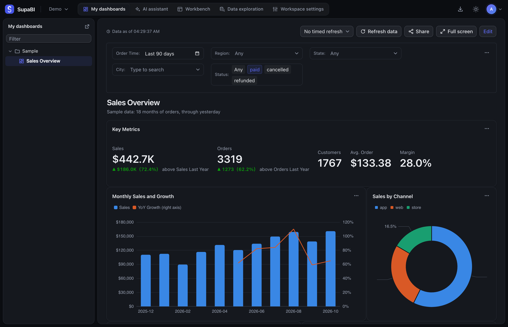
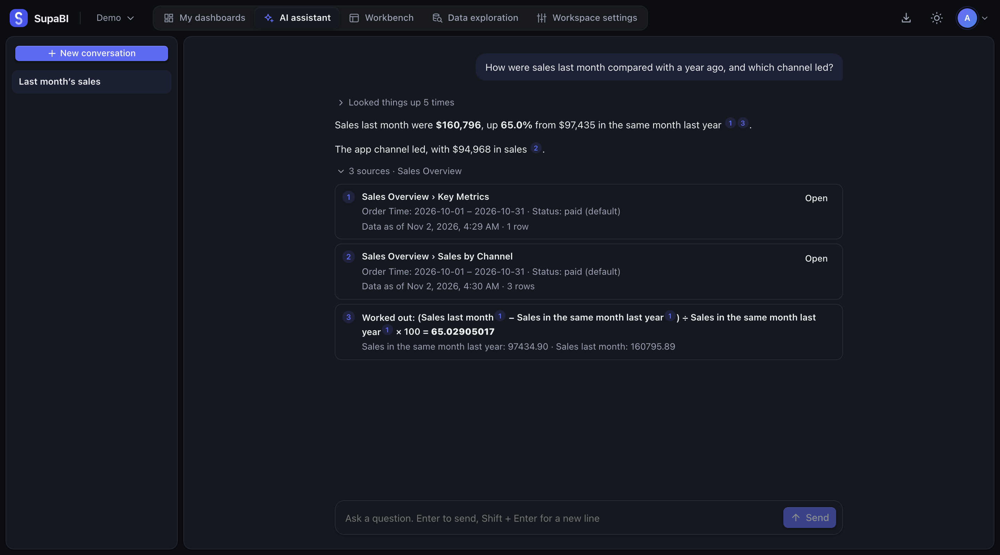

# SupaBI

English | [简体中文](README.zh.md)

Open-source business intelligence: from SQL to dashboards, with an AI assistant that cites its sources.



- **Connect your databases.** PostgreSQL, MySQL, ClickHouse, Apache Doris, StarRocks and Trino.
- **Define data once.** A dataset holds the dimensions, measures and permissions for every chart that reads it.
- **Share dashboards.** Build charts, arrange them on a dashboard, and choose who can see it.
- **Ask the AI assistant.** It reads the dashboards you can open, and marks every number in an answer with its source.



> [!NOTE]
> SupaBI is in early development. It has no releases yet, so it is built from source, and names and behavior may still change.

## Quick start

You need [Docker](https://www.docker.com) and [mise](https://mise.jdx.dev). This runs SupaBI on your machine with sample data:

```bash
git clone https://github.com/supazd/supabi.git
cd supabi
mise install
make dev-up
make dev-seed
make run
```

Open http://localhost:8080 and create the administrator account. Then [build your first dashboard](docs/src/content/docs/getting-started/first-dashboard.md). To run it for a team, see [Install SupaBI](docs/src/content/docs/getting-started/install.md).

SupaBI is released under the [Apache 2.0](LICENSE) license. For the design documents see [.agents/design](.agents/design/architecture.md), and for deferred items see [.agents/backlog.md](.agents/backlog.md).

## Local development

Requires Docker and [mise](https://mise.jdx.dev), which installs Go, Node and pnpm as listed in `mise.toml`.

```bash
make dev-up    # Start local Postgres (port 15432), MySQL, ClickHouse, Redis and RustFS
make dev-seed  # Load the sample data (one copy each in Postgres, MySQL and ClickHouse, with identical content, about 20,000 orders)
make dev-seed-content  # Create a sample dataset, charts and dashboards on the Postgres sample data (create the administrator in the page first)
make test      # Run all tests: frontend checks, backend tests, database and object storage tests
make run       # Build (including the frontend) and start, then open http://localhost:8080
make run-s3    # Same as above, but export files go to the local RustFS (S3 compatible) instead of the data directory
```

The first time you open it, it asks you to create an administrator account. Then add the sample databases on the "Data sources" page. Each of the three databases holds one copy. The user is `supabi_demo` for all of them, the password is `demo`, the data time zone is `Asia/Shanghai` and the host is `127.0.0.1`:

| Type | Port | Database |
|---|---|---|
| PostgreSQL | `15432` | `supabi` (the tables are in the `demo` schema) |
| MySQL | `13306` | `demo` |
| ClickHouse | `19000` | `demo` |
| StarRocks | `19030` | `demo` |
| Doris | `19031` | `demo` |
| Trino | `18080` | catalog `postgres`, schema `demo` (no password, any user name) |

This account can only read the sample data. [dev/seed](dev/seed/main.go) generates the sample data once with a fixed random seed and then writes it to each database, so the copies loaded on the same day are identical. The same question should get the same result in every database; if it does not, the cause is a dialect or driver difference. Orders run up to yesterday (Shanghai time):

| Table | Contents |
|---|---|
| `regions` | 5 sales regions |
| `cities` | 33 cities, each belonging to a region and a province |
| `products` | 27 products, split into categories and subcategories, with a list price and a cost; two products have a cost higher than the list price |
| `orders` | About 20,000 orders, from the 1st of the month 18 months ago to yesterday, growing gradually, with more on weekends and on 618, Double 11 and Double 12; about 2% of the orders have no city and about 1% have no cost |
| `daily_traffic` | Daily visits, product views, add-to-carts and orders for app and web; the order count matches `orders` |
| `monthly_targets` | The sales target of each region for each month |

StarRocks, Doris and Trino are not started by default. Load the StarRocks and Doris sample data with `make dev-seed-olap` (it starts them first). These two containers do not keep their data, so load it again after every restart. Start Trino with `make dev-up-olap`. Its `postgres` catalog reads the sample data in the Postgres above directly, so there is nothing else to load; a separate `memory` catalog is for tests.

What to do from here is in the guides of the [documentation](#documentation), starting with "Build your first dashboard".

When the frontend and backend are developed separately, build and start the backend with `make build-go`, and run `pnpm dev` under `web/` for the frontend; Vite proxies `/api` requests to `:8080`.

| Command | Description |
|---|---|
| `make build` | Builds the binary into `bin/` with the frontend embedded. It does not depend on CGO and is a static binary, so setting `GOOS` and `GOARCH` is enough to cross-compile |
| `make build-go` | Builds only the backend; Node is not needed, and the binary does not contain the frontend |
| `make web-check` | The frontend type check, lint and tests |
| `make dev-up` | Starts the local dependencies: Postgres (the metadata database, also used for tests), MySQL and ClickHouse (for tests only), Redis (for `--query-cache=redis` and its tests, port 16379), RustFS (S3-compatible object storage, for `--export-storage=s3` and its tests; the S3 API is on port 19100, the admin console is at http://127.0.0.1:19101/rustfs/console/, the access keys are `supabi` / `supabi-secret`, and the bucket `supabi` is created automatically) |
| `make test-olap` | Starts StarRocks, Doris and Trino in turn (the images are all large) and runs their driver tests |
| `make generate` | Regenerates the backend stubs and the frontend types after `api/openapi.yaml` changes |
| `make dev-down` | Stops all local dependencies, including StarRocks, Doris and Trino (the data stays in Docker volumes) |
| `make dev-up-olap` / `make dev-down-olap` | Starts / stops only StarRocks, Doris and Trino; the other local dependencies are not affected |
| `make dev-seed-olap` | Starts StarRocks and Doris and loads the sample data |
| `make dev-seed-content` | First loads the Postgres sample data, then creates sample content in SupaBI: the data source "示例 PostgreSQL", 5 datasets, 27 charts (covering all chart types, 7 of which can drill down and 3 of which use dataset parameters) and 4 dashboards (the dashboards "下钻" and "参数" say what to test in each chart), each placed in its own "示例" folder. The administrator must be created in the page first; the content is created in the first workspace of that administrator. Running it again deletes what the last run created (names that start with "示例 · ") and creates it again. When the secret key used by the service is not the `DEV_SECRET_KEY` in the Makefile, pass `DEV_SECRET_KEY=<service-secret-key>` when running it |
| `make run-s3` | The same as `make run`, but export files go to the RustFS started by `make dev-up` (under `exports/` in the bucket `supabi`), for trying out and testing `--export-storage=s3` |
| `make dev-reset` | Restores the initial state: stops the local dependencies and deletes the development database, the files in RustFS and the local export files |

## Running

Building, configuring and running SupaBI are covered under "Getting started" and "Deployment" in the [documentation](#documentation). The API is defined in [api/openapi.yaml](api/openapi.yaml).

## Database migrations

Migration files are in `internal/store/migrations/`, named `NNNN_description.sql`, and go forward only. A file that has been applied must not be modified; when a change is needed, add a new file.

Every table and every field must have a `COMMENT`, written in the migration file that adds it; a test fails when one is missing.

## Frontend

The frontend is in `web/`, a pnpm workspace:

| Package | Contents |
|---|---|
| `packages/ui` | Components and design tokens. The only place allowed to import low-level component libraries such as shadcn/ui and Radix |
| `packages/charts` | Chart specs, adapters and render components. The only place allowed to import ECharts |
| `apps/app` | The app itself, which may use only the two packages above |

These boundaries are enforced by lint rules. All UI text is in the language packs under `apps/app/src/i18n/` and is not hard-coded in components.

## Documentation

The documentation for people who install and use SupaBI is in `docs/`, a [Starlight](https://starlight.astro.build) site in English and Chinese, kept apart from the frontend workspace. `make docs-dev` starts it at http://localhost:4321, and `make docs-build` builds the static site into `docs/dist/`. For the rules its pages follow see [Documentation site](.agents/design/docs-site.md).
