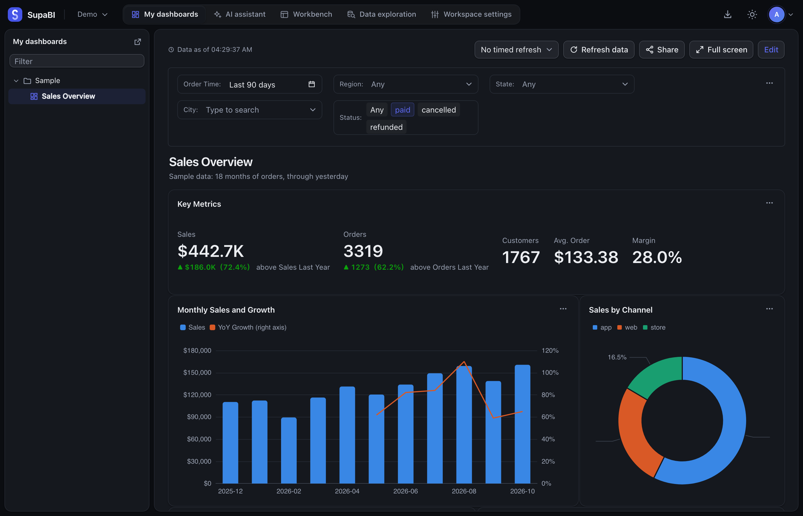
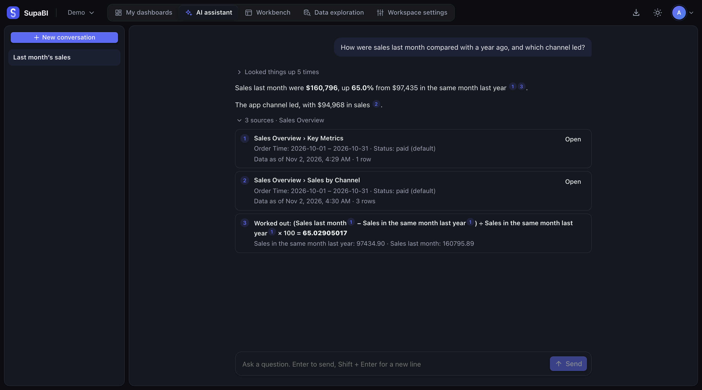

# SupaBI

[English](README.md) | 简体中文

开源商业智能，从 SQL 到仪表盘，AI 助手的回答都标明出处。



- **连接你的数据库。** PostgreSQL、MySQL、ClickHouse、Apache Doris、StarRocks 和 Trino。
- **数据只定义一次。** 数据集统一保存维度、度量和权限，读取它的图表都会用到。
- **分享仪表盘。** 制作图表，排到仪表盘上，再决定谁能看。
- **问 AI 助手。** 它读取你能打开的仪表盘，回答里的每个数字都标明出处。



> [!NOTE]
> SupaBI 处于早期开发阶段，还没有发布版本，需要从源码构建，名称和行为也可能变化。

## 快速开始

你需要 [Docker](https://www.docker.com) 和 [mise](https://mise.jdx.dev)。下面的命令会在自己的机器上用示例数据运行 SupaBI：

```bash
git clone https://github.com/supazd/supabi.git
cd supabi
mise install
make dev-up
make dev-seed
make run
```

打开 http://localhost:8080，创建管理员账号，然后[制作第一个仪表盘](https://supazd.github.io/supabi/zh-cn/getting-started/first-dashboard/)。要给团队使用，见[安装 SupaBI](https://supazd.github.io/supabi/zh-cn/getting-started/install/)。

SupaBI 以 [Apache 2.0](LICENSE) 协议开源。设计文档见 [.agents/design](.agents/design/architecture.zh.md)，暂缓事项见 [.agents/backlog.zh.md](.agents/backlog.zh.md)。

## 本地开发

需要 Docker，以及 [mise](https://mise.jdx.dev)（按 `mise.toml` 安装 Go、Node、pnpm）。

```bash
make dev-up    # 启动本地 Postgres（端口 15432）、MySQL、ClickHouse、Redis、RustFS
make dev-seed  # 载入示例数据（Postgres、MySQL、ClickHouse 各一份，内容完全相同，约两万笔订单）
make dev-seed-content  # 在 Postgres 示例数据上建示例数据集、图表和仪表盘（需先在页面上创建管理员）
make test      # 运行全部测试：前端检查、后端测试、数据库和对象存储测试
make run       # 构建（含前端）并启动，访问 http://localhost:8080
make run-s3    # 同上，但导出文件存到本地的 RustFS（S3 兼容），而不是 data 目录
```

首次打开时会要求创建管理员账号。之后在「数据源」页添加示例库，三个数据库里各有一份，用户都是 `supabi_demo`，密码 `demo`，数据时区 `Asia/Shanghai`，主机 `127.0.0.1`：

| 类型 | 端口 | 数据库 |
|---|---|---|
| PostgreSQL | `15432` | `supabi`（表在 `demo` schema 中） |
| MySQL | `13306` | `demo` |
| ClickHouse | `19000` | `demo` |
| StarRocks | `19030` | `demo` |
| Doris | `19031` | `demo` |
| Trino | `18080` | catalog `postgres`，schema `demo`（不用密码，用户名随意） |

这个账号只能读取示例数据。示例数据由 [dev/seed](dev/seed/main.go) 用固定的随机种子生成一次，再写入每个数据库，所以同一天载入的各份数据完全相同，同一个问题在各个数据库里应该得到同样的结果；对不上就是方言或驱动的差异。订单截至昨天（上海时间）：

| 表 | 内容 |
|---|---|
| `regions` | 5 个销售大区 |
| `cities` | 33 个城市，分属各大区和省份 |
| `products` | 27 种商品，分品类和子品类，带标价和成本；有两种商品成本高于标价 |
| `orders` | 约两万笔订单，从 18 个月前那个月的 1 号到昨天，逐渐增长，周末和 618、双 11、双 12 更多；约 2% 的订单城市为空，约 1% 成本为空 |
| `daily_traffic` | app 和 web 每天的访问、商品浏览、加购和下单数，下单数与 `orders` 一致 |
| `monthly_targets` | 每月每个大区的销售目标 |

StarRocks、Doris 和 Trino 平时不启动。StarRocks 和 Doris 的示例数据用 `make dev-seed-olap` 载入（会先把它们启动起来），这两个容器不保留数据，每次重新启动后都要再载入一次。Trino 用 `make dev-up-olap` 启动，它的 `postgres` catalog 直接读上面 Postgres 里的示例数据，不用另外载入；另有一个 `memory` catalog 给测试用。

接下来怎么做，见[文档](#文档)里的指南，从“制作第一个仪表盘”开始。

前后端分开开发时，后端用 `make build-go` 构建并启动，前端在 `web/` 下运行 `pnpm dev`，Vite 会把 `/api` 请求代理到 `:8080`。

| 命令 | 说明 |
|---|---|
| `make build` | 构建二进制到 `bin/`，内嵌前端。不依赖 CGO，是静态二进制，设置 `GOOS`、`GOARCH` 即可交叉编译 |
| `make build-go` | 只构建后端，不需要 Node，二进制不含前端 |
| `make web-check` | 前端的类型检查、lint、测试 |
| `make dev-up` | 启动本地依赖：Postgres（元数据库，也用于测试），MySQL、ClickHouse（仅用于测试），Redis（`--query-cache=redis` 和它的测试，端口 16379），RustFS（S3 兼容的对象存储，用于 `--export-storage=s3` 和它的测试，S3 接口在端口 19100，管理界面在 http://127.0.0.1:19101/rustfs/console/，访问密钥 `supabi` / `supabi-secret`，自动建好 bucket `supabi`） |
| `make test-olap` | 依次启动 StarRocks、Doris 和 Trino（镜像都很大）并运行它们的驱动测试 |
| `make generate` | 修改 `api/openapi.yaml` 后重新生成后端桩代码和前端类型 |
| `make dev-down` | 停止全部本地依赖，包括 StarRocks、Doris 和 Trino（数据保留在 Docker 卷中） |
| `make dev-up-olap` / `make dev-down-olap` | 启动 / 只停止 StarRocks、Doris 和 Trino，其余本地依赖不受影响 |
| `make dev-seed-olap` | 启动 StarRocks 和 Doris 并载入示例数据 |
| `make dev-seed-content` | 先载入 Postgres 的示例数据，再在 SupaBI 里建示例内容：数据源「示例 PostgreSQL」、5 个数据集、27 张图表（覆盖全部图表类型，其中 7 张能下钻，3 张用到数据集参数）和 4 个仪表盘（「下钻」和「参数」仪表盘里写了每张图要测什么），放在各自的「示例」文件夹里。需要先在页面上创建管理员，内容建在这个管理员的第一个工作空间里。重复运行会删掉上次建的（名称以「示例 · 」开头）再重建；服务用的密钥不是 Makefile 里的 `DEV_SECRET_KEY` 时，运行时带上 `DEV_SECRET_KEY=服务的密钥` |
| `make run-s3` | 与 `make run` 相同，但导出文件存到 `make dev-up` 启动的 RustFS（bucket `supabi` 下的 `exports/`），用来试用和测试 `--export-storage=s3` |
| `make dev-reset` | 还原到最初状态：停止本地依赖，并删除开发数据库、RustFS 中的文件和本地的导出文件 |

## 运行

构建、配置和运行 SupaBI 的方法，见[文档](#文档)的“快速开始”和“部署”。API 定义在 [api/openapi.yaml](api/openapi.yaml)。

## 数据库迁移

迁移文件在 `internal/store/migrations/`，命名为 `NNNN_描述.sql`，只进不退。已经应用过的文件不能修改，需要变更时新增一个文件。

每张表和每个字段都要有 `COMMENT`，写在新增它的那个迁移文件里；缺少时测试会失败。

## 前端

前端在 `web/`，是一个 pnpm 工作区：

| 包 | 内容 |
|---|---|
| `packages/ui` | 组件与设计变量。唯一允许引入 shadcn/ui、Radix 等底层组件库的地方 |
| `packages/charts` | 图表 Spec、适配器、渲染组件。唯一允许引入 ECharts 的地方 |
| `apps/app` | 应用本身，只能使用上面两个包 |

以上边界由 lint 规则强制。界面文案全部在 `apps/app/src/i18n/` 的语言包里，不在组件中写死。

## 文档

给安装和使用 SupaBI 的人看的文档在 https://supazd.github.io/supabi/zh-cn/。源文件在 `docs/`，是一个中英双语的 [Starlight](https://starlight.astro.build) 站点，和前端工作区分开，`main` 上改动了它的推送会重新发布它。`make docs-dev` 在 http://localhost:4321/supabi/ 启动它，`make docs-build` 把静态站点构建到 `docs/dist/`。页面要遵守的规则见[文档站](.agents/design/docs-site.zh.md)。
